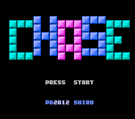
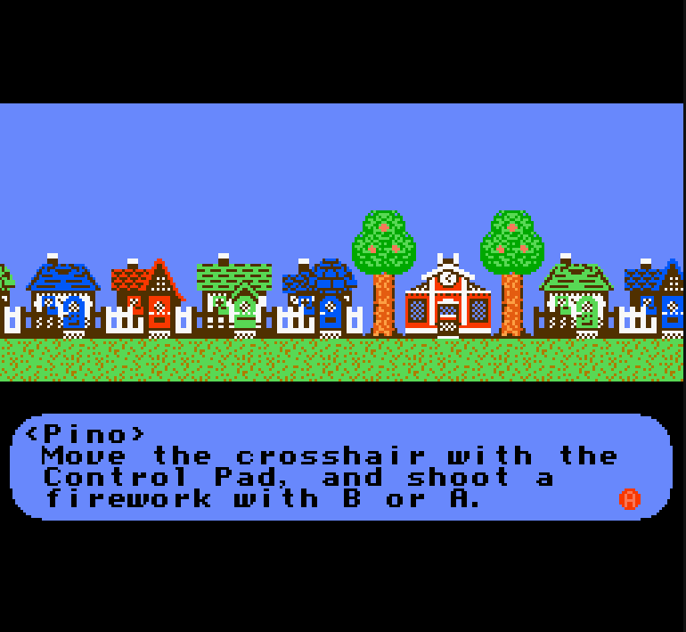
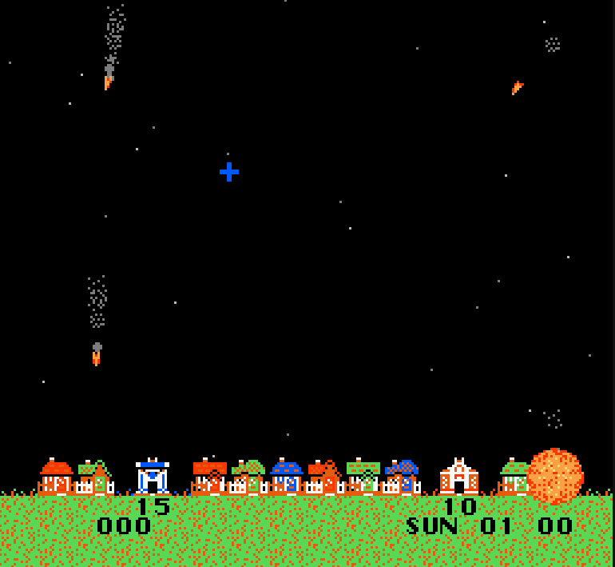
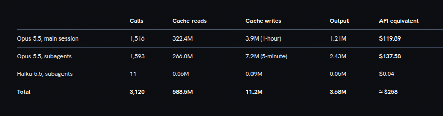
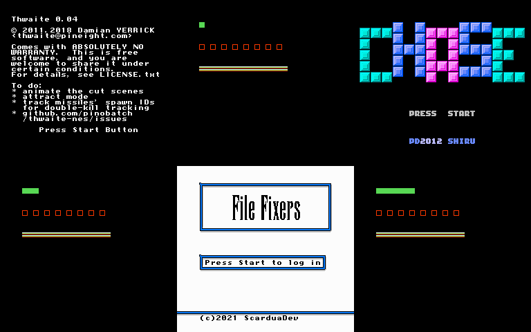

# nes

A NES emulator in TypeScript that plays in the browser, with sound. It needs no build step and has no
runtime dependencies. It comes with three free homebrew games, so you can clone it and play.

<p>
  
  
  
</p>

It was built by an AI coding agent: Claude, run by the [agentFNG](#how-it-was-built) harness. The agent
worked increment by increment against the community's test ROMs, unattended apart from a few approval
gates.

## Play
You need [Node.js](https://nodejs.org/) 24 or later. Nothing else is installed for play.

```sh
git clone https://github.com/dreddnafious/nes.git
cd nes
npm start                 # or: node src/web/serve.ts --port 8080
```
If port 8080 is taken, choose another with `node src/web/serve.ts --port 8081`.

Open http://127.0.0.1:8080/. Choose a game from **Games** beside the file picker, or pick a `.nes` file of
your own with **ROM file**. The first key press or click turns the sound on (browsers hold sound back until
then).

| key | button |
|---|---|
| arrow keys | the pad |
| X | A |
| Z | B |
| Enter | Start |
| Right Shift | Select |

- **Reset** is the console's reset button: the game restarts and RAM is kept.
- **Power** turns the console off and on: a fresh start, though a battery save is kept while the page is open.
- **Changing games:** pick another game at any time. It starts clean, and nothing of the last game carries
  over.
- **Hidden tab:** the game pauses while its tab is hidden, and carries on where it was when you come back.

The server listens on 127.0.0.1 only. It strips the TypeScript's types as it serves each file, which is why
there's no build step.

## The games included
| game | author | cartridge (mapper) | licence |
|---|---|---|---|
| [Thwaite](https://github.com/pinobatch/thwaite-nes): defend the town from falling missiles | Damian Yerrick | NROM (0) | GPL-3.0-or-later |
| [Chase](https://github.com/djkunkel/chase30): run from the enemy | Shiru (512 KiB build by djkunkel) | UxROM (2) | public domain |
| [File Fixers](https://github.com/wendelscardua/file-fixers): a turn-based RPG inside an operating system | Wendel Scardua | MMC3 (4) | MIT |

Each game's terms, source and SHA-256 are recorded in [`roms/LICENSES.md`](roms/LICENSES.md), and the full
licence texts are in [`roms/licenses/`](roms/licenses/). No commercial ROM is in this repository, and none
ever will be.

## What it emulates
- **The CPU:** the 6502 (2A03), cycle-counted, including the unofficial opcodes, interrupts and their
  timing, and DMA.
- **The PPU:** dot-timed rendering, scrolling and mid-frame splits, sprites, sprite-0 hit and overflow,
  emphasis and greyscale.
- **The APU:** both pulse channels, the triangle, noise and DMC, the frame counter and its IRQ, and the
  hardware's nonlinear mixer. Sound plays through an AudioWorklet, resampled to your device's rate.
- **Cartridges:** iNES and NES 2.0 files on mappers 0 (NROM), 1 (MMC1 / SxROM), 2 (UxROM), 3 (CNROM),
  4 (MMC3 / TxROM, with its scanline IRQ) and 7 (AxROM). Battery-backed PRG-RAM and trainers are handled.
  A file on any other mapper is refused with a message naming its number.
- **Timing:** NTSC, at 60.0988 frames a second. On a 60 Hz display, each refresh shows exactly one new
  frame. On other displays, frames are paced against real time.

Not done: PAL timing (a PAL game runs at NTSC speed, and the page says so), other mappers, gamepads, save
states, and keeping battery saves across a page reload.

## How the code is laid out
- `src/core`: the console. It is pure TypeScript with no DOM, so the same code runs headless under Node
  and in the browser. Its public API is `src/core/index.ts`: `NES`, `RomError` and `MAPPERS`.
- `src/web`: the page, which holds the canvas, the keyboard, the sound worklet and the game menu, and the
  small local server.
- `src/cli`: a headless command line, for traces, screenshots and sound:

  ```sh
  node src/cli/nes.ts trace <rom.nes> [--pc <hex>] [--lines <n>] [--mem <hexaddr>:<n>]...
  node src/cli/nes.ts run   <rom.nes> [--frames <n>] [--mem <hexaddr>:<n>]...
  node src/cli/nes.ts screenshot <rom.nes> [--frames <n>] --out <file.png>
  node src/cli/nes.ts audio <rom.nes> [--frames <n>] [--rate <hz>] --out <file.wav>
  ```

## Tests
The tests are in Python and drive the emulator as its users meet it: the CLI, the core's API, and the page
in headless Chromium.

```sh
npm install                                      # the type-checker (a dev dependency only)
uv venv .venv && uv pip install --python .venv/bin/python -r requirements-dev.txt
.venv/bin/python -m playwright install chromium

npm test                  # the corpus (cases/, 563 cases) and the project's tests (tests/)
npm run typecheck         # the source under strict mode
npm run smoke             # the smoke run: every mapper, end to end in the browser
```

- **Test ROMs:** the corpus judges accuracy by the community's test ROMs, and runs no other emulator. It
  uses blargg's CPU, APU, PPU and sprite-hit suites, `nestest` with its golden trace, `ppu_vbl_nmi`,
  `cpu_interrupts_v2`, `dmc_dma_during_read4`, and Holy Mapperel for the mappers. They aren't in git: each
  is fetched on first use by URL and checked by SHA-256 (see `cases/oracles.json`).
- **The contracts:** what the tests drive is written down in `cases/CONTRACT*.md`.
- **The smoke run** (`npm run smoke`) needs nothing from the network. It serves the page on a free port and
  loads a game or a probe cartridge on every supported mapper, through the file input and the game menu.
  It checks:
  - the title against `smoke/references/`;
  - that a key changes the screen;
  - that sound reaches the output;
  - that Reset and Power bring the title back.

  It writes `out/smoke/<run>/report.md`, with a JSON twin and the frames it judged, and exits non-zero if
  anything failed. `npm run smoke -- --mapper 4` runs one mapper's checks.
- **Adding a game:** a game added to `roms/games/` fails the smoke run's title check until it has a
  reference. Give it a row in `smoke/subjects.json`, run `.venv/bin/python -B smoke/make_references.py
  <name>`, look at the picture, and commit both.

## How it was built
**An agentFNG harness run built a playable NES emulator in TypeScript that runs in the browser. Apart from
a few approval gates, all of it ran unattended after the opening design session. It took about 26
hours.**

The harness ran Claude (Opus) through *climbs*. A climb turns a design brief into a frozen set of tests, then
builds until every test passes. The person's part was the design session at the start of each climb: what
"done" means, the user journeys, and the roadmap. After that came a gate at each new increment's tests
(three were the person's; the harness's written rules decided the rest), and the merge gate at the end.
Everything else was the agent's.

The brief that started it is [`brief.md`](brief.md). In the person's words, a game must "start. You can
play it. It ends. You can restart it without having to reload the browser or do anything unusual. It
includes audio."

**How a climb works:**
1. **Corpus first.** Each increment's promises are written as test cases before any code, from the brief,
   the hardware documentation (NESdev) and the test ROMs. The cases are reviewed for coverage and then
   approved and frozen. After that the agent can't edit, weaken or delete a case. A case with a defect in
   the case itself, not in its promise, can be fixed only through a narrow lane that proves the fix weakens
   nothing.
2. **Climb to green.** The agent builds until the frozen corpus passes, counting each run and watching for
   a plateau. An increment it can't finish honestly is parked with a written account of what it tried,
   rather than gamed.
3. **Held-out tests.** A separate agent writes tests the builder never sees, from the same brief. They are
   sealed and run only once the corpus is green.
4. **Ship and review.** Each increment is its own pull request, stacked on the last. Two fresh reviewer
   agents and GitHub Copilot read it, and what they find is triaged, fixed with a test, or left to the
   person.

**The rules it worked under:**
- **Accuracy:** "accurate" means passing the test ROMs.
- **Honesty:** no other emulator may be copied, called or vendored, and a test checks that nothing under
  `src/` starts another process.
- **Legal:** no commercial ROM, ever. Every game is licence-checked before it is vendored, and every web
  search or fetch is logged.

| | |
|---|---|
| Elapsed time | about 26 hours over 29-30 October 2026, in two climbs (12.6 h and 13.6 h). About 6 of those hours were spent waiting on the person at gates and design sessions |
| Increments | 9, merged as 10 stacked pull requests ([#1](https://github.com/dreddnafious/nes/pull/1)-[#10](https://github.com/dreddnafious/nes/pull/10)) |
| Test cases | 563, all passing, from 138 test ROMs and oracles |
| Held-out tests | every sealed set passed: 15 of 15 in the first climb, 8 of 8 at the end of the second |
| Code | about 3,500 lines of TypeScript (2,600 of them the core) |
| Human code | none; the person wrote the brief's intent and approved at the gates |

**The increments**, in the order they were built:

| PR | increment | what it added |
|---|---|---|
| #1 | I1 | the 6502 core, the cartridge loader and the headless CLI |
| #2 | I2 | the PPU, and PNG screenshots |
| #3 | I3 | the first playable page: the local server, file input, canvas, keyboard, Reset and Power |
| #4 | I4 | the APU and the page's sound |
| #5 | I6 | the discrete mappers: UxROM, CNROM and AxROM |
| #6 | I7 | MMC1 |
| #7 | I8 | MMC3 and its scanline IRQ |
| #8 | I5 | long sessions: the 60 Hz display lock, a steady sound buffer, and pausing in a hidden tab |
| #9 | I9 | the collection: the game menu, switching games cleanly, and the three games vendored |
| #10 | I10 | the smoke run and the core's mapper registry |

**Model usage** for the build:



The smoke run against the merged `main` passed every check on every mapper: 51 passed, and 3 N/A (a
probe cartridge has no game-menu entry). These are the title frames it judged: Thwaite, the MMC1 probe and
Chase on top, and the CNROM probe, File Fixers and the AxROM probe below.



## Credits
- **The games:** Damian Yerrick (Thwaite), Shiru and djkunkel (Chase), and Wendel Scardua (File Fixers),
  with their music credited in [`roms/LICENSES.md`](roms/LICENSES.md).
- **The test ROMs:** blargg (Shay Green), kevtris (`nestest`), and Damian Yerrick (Holy Mapperel), among
  others listed in `cases/oracles.json`.
- **The hardware documentation:** the [NESdev wiki](https://www.nesdev.org/wiki/), read for its spec
  facts.
